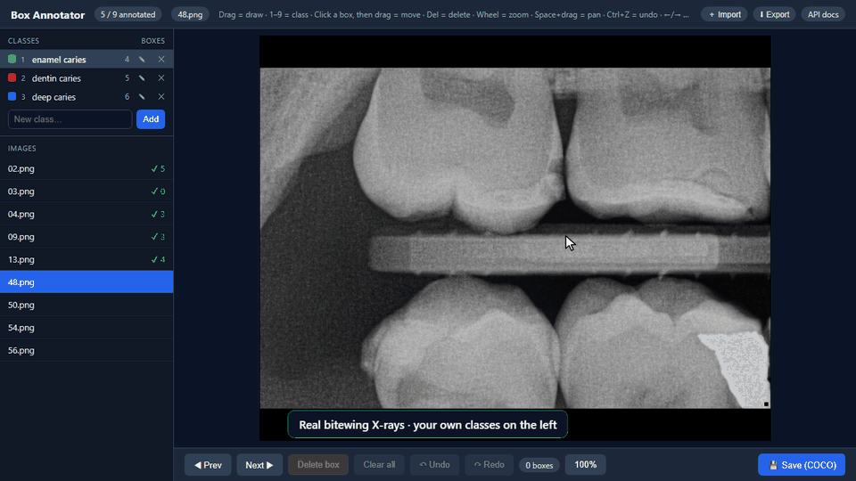
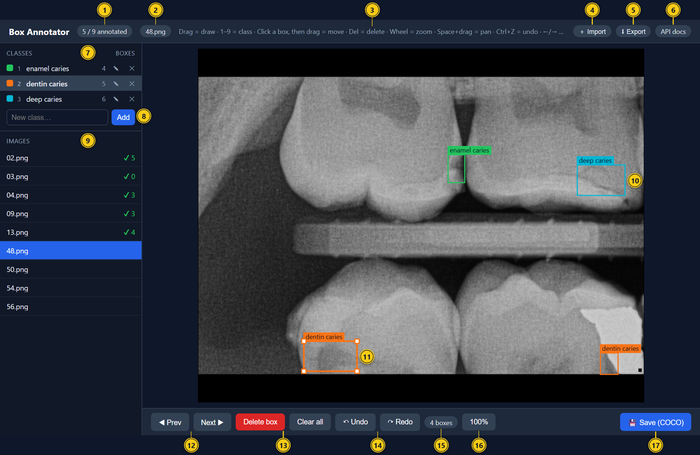
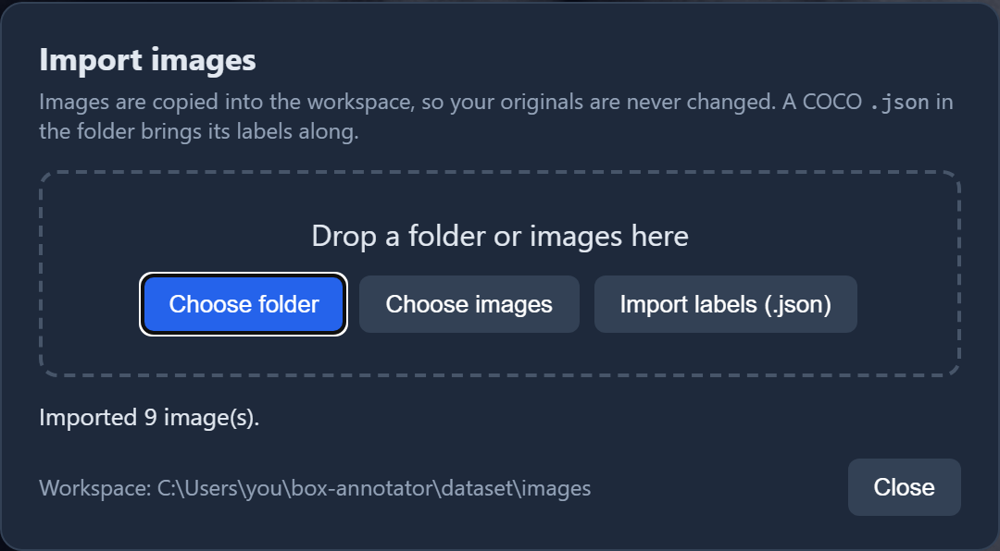
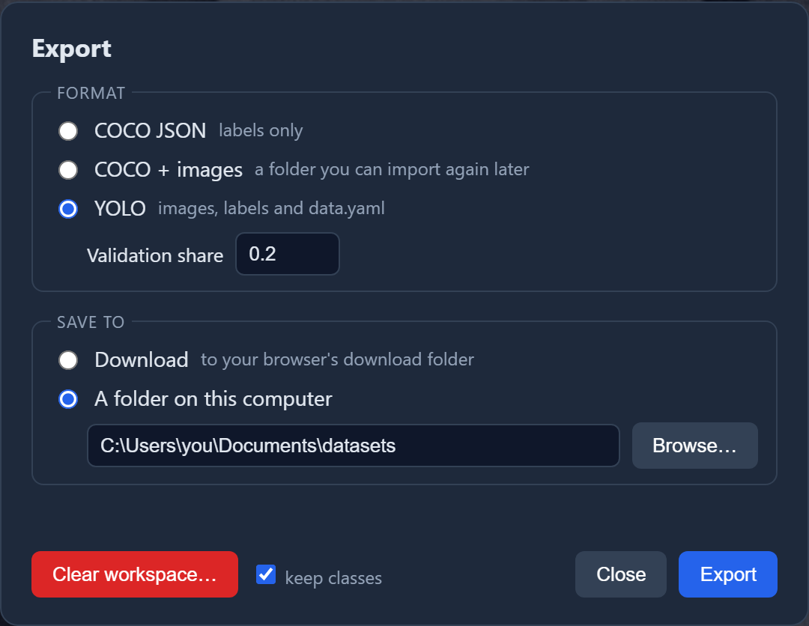

# Box Annotator

[](https://github.com/Kratosdoritos/box-annotator/actions/workflows/tests.yml)
[](LICENSE)

Draw labelled boxes on images in your browser and export them as a **COCO** or **YOLO** dataset to train an object detector. You choose the classes, so it works for any kind of image. It runs on your own computer: images are never uploaded.



<sub>X-rays from <a href="https://doi.org/10.17632/4fbdxs7s7w.1">Dental caries in bitewing radiographs</a> (Kybic, Tichý, Kunt; Mendeley Data, 2023), <a href="https://creativecommons.org/licenses/by-nc/3.0/">CC BY-NC 3.0</a>. Boxes are the dataset's expert annotations; the depth classes are illustrative, not a diagnosis.</sub>

I built this as the solo developer on a university project with a medical team. One stage was training a model on dental X-rays, and the dataset had to be built from scratch, so I needed something faster than the available tools. It does boxes only, on one computer, because it was designed for a computer the team shared.

## Install and start

Requires [Python](https://www.python.org/downloads/) 3.10+.

```bash
git clone https://github.com/Kratosdoritos/box-annotator.git
cd box-annotator
```

Windows:

```powershell
py -m venv .venv
.venv\Scripts\python -m pip install -r requirements.txt
.venv\Scripts\python -m uvicorn app.main:app
```

macOS / Linux:

```bash
python3 -m venv .venv
.venv/bin/python -m pip install -r requirements.txt
.venv/bin/python -m uvicorn app.main:app
```

Open <http://127.0.0.1:8000>. Next time: `cd box-annotator`, then the last line.

## How to use



| # | |
|---|---|
| 1 | Images saved so far |
| 2 | Current image |
| 3 | Shortcuts (hover for the full list) |
| 4 | Import images or labels |
| 5 | Export, and clear the workspace |
| 6 | API docs |
| 7 | Classes: shortcut key, saved boxes, ✎ rename, ✕ delete (only while unused) |
| 8 | Add a class |
| 9 | Images: ✔ = saved, with its box count |
| 10 | A box, coloured by class |
| 11 | The selected box: click it, then drag to move; drag a corner to resize |
| 12 | Previous / next image |
| 13 | Delete the selected box / every box on this image |
| 14 | Undo / redo |
| 15 | Boxes on this image |
| 16 | Zoom level; click to see the whole image |
| 17 | Save and open the next image |

### 1. Import



Choose a folder or images, or drop them anywhere on the page. JPG, PNG and BMP images are copied into the app, so your originals are never changed. A COCO `.json` in the folder brings its labels along, or add one later with **Import labels (.json)**. If your browser asks to "upload" the files, that only means to the app on your own computer.

### 2. Label

1. Add your classes: type a name under **Classes** and press `Enter`.
2. Pick a class with `1`–`9` and drag on the image to draw a box.
3. Click **💾 Save (COCO)**. The next image opens.

| Key / mouse | Action |
|---|---|
| `1`–`9` | Pick a class (also re-classes the selected box) |
| Click a box, then drag | Move it |
| `Delete` | Delete the selected box |
| `Ctrl`+`Z` / `Ctrl`+`Y` | Undo / redo |
| Wheel or `+` / `-` | Zoom |
| `Space`+drag or middle-drag | Pan |
| `0` | Whole image |
| `←` / `→` | Previous / next image |

Saving an image with no boxes marks it as checked (`✔ 0`). The app asks before discarding unsaved boxes.

### 3. Export



| Format | Contains |
|---|---|
| COCO JSON | The labels, as one `.json` file |
| COCO + images | Labels and images; import it again to carry on labelling |
| YOLO | Images, labels and `data.yaml`, split into train and val (validation share `0.2` = 20%) |

Save it as a download (a `.zip` when it includes images) or into a folder. Each export is named with the date and time, so none is overwritten.

### 4. Clear the workspace

**Clear workspace…** in the Export window deletes the imported images and labels; your originals and exports are not touched. It warns you if labels changed since your last export. Leave **keep classes** ticked to reuse them for the next batch.

## Advanced

### Label a folder in place

Point `ANNOTATOR_DATASET_DIR` at a folder with an `images/` subfolder. Labels are written to `coco_annotations.json` beside it, and imports go into its `images/`. Clear workspace is hidden, so nothing there is ever deleted.

```bash
ANNOTATOR_DATASET_DIR=/data/xrays uvicorn app.main:app          # macOS/Linux
$env:ANNOTATOR_DATASET_DIR="D:\xrays"; uvicorn app.main:app     # Windows PowerShell
```

### Label format

Labels are saved as you go to `dataset/coco_annotations.json`, in standard COCO. Boxes are `[x, y, width, height]` in the image's original pixels.

```json
{
  "images": [{ "id": 1, "file_name": "R1.jpg", "width": 1024, "height": 768 }],
  "annotations": [{
    "id": 1, "image_id": 1, "category_id": 2,
    "bbox": [412.5, 220.0, 64.0, 58.25], "area": 3728.0,
    "segmentation": [], "iscrowd": 0
  }],
  "categories": [
    { "id": 1, "name": "enamel caries", "supercategory": "" },
    { "id": 2, "name": "dentin caries", "supercategory": "" }
  ]
}
```

### YOLO from the command line

```bash
python -m app.yolo                                        # writes dataset/yolo/
python -m app.yolo --out ../my_yolo --val 0.15 --seed 42
pip install ultralytics                                   # only to train
yolo detect train data=dataset/yolo/data.yaml model=yolo11n.pt
```

```
dataset/yolo/
  images/train/  images/val/
  labels/train/  labels/val/     "class x_center y_center width height" (0–1)
  data.yaml                      paths + class names
```

- Classes are numbered 0, 1, 2, … in class-id order.
- Only saved images are exported; one with no boxes gets an empty label file (a background image).
- The same `--seed` gives the same split. An earlier export is only replaced with `--overwrite`.

### Big datasets

Measured with 20,000 images, 200,000 boxes and a 10000×7500 photo:

| Task | Time |
|---|---|
| Open the app | about 2 s |
| Open an image's boxes | under 20 ms |
| Save an image | under 1 s |
| Open the 10000×7500 photo | under 1 s |
| Build a 1 GB zip export | about 25 s |

### Safety

- Saves are atomic. An unreadable labels file is set aside, never overwritten.
- Saves, imports, class edits and clears run one at a time, so simultaneous requests can't lose labels. This holds within one process: don't start uvicorn with `--workers`.
- Imports never replace existing images or labels, and only accept real JPEG, PNG and BMP files.
- A class can't be deleted while a box uses it.
- A download counts as exported only once all of it has arrived.
- The app only listens on your computer. It refuses requests from other websites or host names (DNS rebinding), and other sites can't show it inside their pages.
- To open it from your network, start it with `--host 0.0.0.0`. There is no login: anyone on that network can then see the images and change the labels, so only do this on a network you trust. Exporting to a folder and Clear workspace still only work on the computer itself. To use a computer name instead of the IP, list it in `ANNOTATOR_ALLOWED_HOSTS` (e.g. `mypc,mypc.local`).

### API

Interactive docs: <http://127.0.0.1:8000/docs>.

| Method | Path | Description |
|---|---|---|
| `GET` | `/api/images` | Images with saved status and box counts |
| `GET` / `PUT` | `/api/images/{file_name}` | Get an image / import one (raw bytes; `409` if a different file has the name) |
| `GET` / `PUT` | `/api/annotations/{file_name}` | Get / replace an image's boxes: `{ "width", "height", "boxes": [{ "x", "y", "w", "h", "category_id" }] }` |
| `GET` / `POST` | `/api/categories` | List classes with box counts / add one: `{ "name" }` |
| `PATCH` / `DELETE` | `/api/categories/{id}` | Rename: `{ "name" }` / delete (`409` while in use) |
| `GET` | `/api/coco` | The labels file |
| `POST` | `/api/import/coco` | Merge labels from a COCO file |
| `GET` | `/api/export/{format}` | Download `coco`, `coco_images` or `yolo` (`?val=0.2&seed=0`) |
| `POST` | `/api/export/{format}` | Export into a folder: `{ "folder", "val", "seed" }` |
| `POST` | `/api/export/{format}/download` | Prepare a one-time download link: returns `{ "url", "name" }` |
| `GET` | `/api/downloads/{token}/{name}` | That download; deleted once fully sent |
| `POST` | `/api/pick-folder` | Open this computer's folder picker: `{ "start" }`, returns `{ "path" }` |
| `GET` | `/api/workspace` | Workspace status |
| `POST` | `/api/workspace/clear` | Delete imported images and labels: `{ "keep_classes", "force" }` (`409` if not exported; this computer only) |

### Tests

```bash
pip install -r requirements-dev.txt
playwright install chromium     # Linux: playwright install --with-deps chromium
pytest
ruff check .                    # lint
```

The tests cover the API, classes, the YOLO conversion, import and export, and drive the real UI in headless Chromium with Playwright. Each runs on a temporary dataset. `ANNOTATOR_TEST_HEADED=1` shows the browser; `ANNOTATOR_TEST_BROWSER=<path>` uses another Chromium-based browser.

### Project structure

FastAPI · Pydantic · vanilla JS modules and canvas (no build step) · pytest + Playwright

```
app/
  main.py          FastAPI app
  routes.py        image, label and class endpoints
  workspace.py     import, export, folder picker, clear
  exports.py       writing an export to a folder or zip
  coco.py          labels file: load, save, locking
  yolo.py          COCO -> YOLO (python -m app.yolo)
  schemas.py       request models
  config.py        dataset path, logging
  static/          the UI: index.html, style.css
  static/js/       its modules: main (start-up, keys), canvas, images, classes, dialogs, history, state, ui, api
dataset/           workspace (git-ignored)
docs/              README images and their license
tests/
```

## License

Code: [MIT](LICENSE). The X-rays in `docs/` are CC BY-NC 3.0 and not covered by the MIT license: see [docs/LICENSE.md](docs/LICENSE.md).
